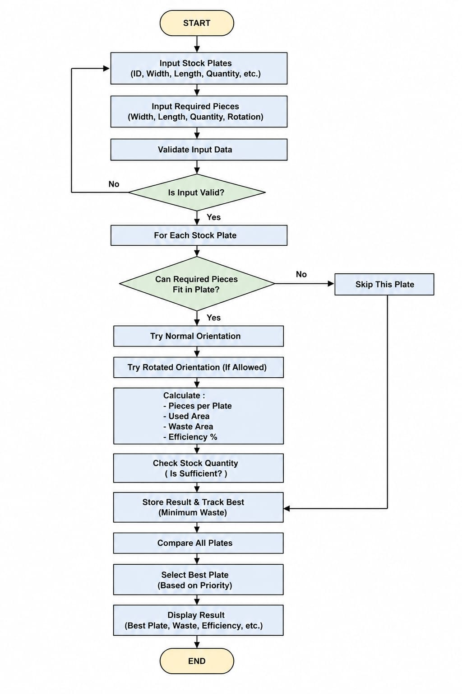

# ✂️ SteelCut Plate Optimizer

**A C++ tool built for a real iron-cutting workshop: it picks the best steel plate for each job, cuts material waste, and generates an instant customer quotation.**

  

---

## 🏭 The Real-World Problem

A local **iron-cutting workshop** was choosing plates and estimating waste **by hand**. That led to:
- ❌ Wasted steel from poor plate choices
- ❌ Slow, error-prone manual calculations
- ❌ No quick way to give customers a price

**Our solution:** a program that tests every plate in stock, finds the one with the **least waste**, and prints a full **invoice** in seconds.

It was tailored to the owner's **cutting machine**: if a piece doesn't fit in its normal orientation, the optimizer **automatically tries rotating it 90°**. The tool helped the owner **increase cutting efficiency and reduce waste**.

---

## 📌 At a Glance

| | |
|---|---|
| **Course** | CSI 205L: Programming I Lab, American University of Science & Technology (AUST) |
| **Date** | Spring 2026 |
| **Client** | Local iron-cutting workshop, Lebanon |
| **Team** | 4 students |
| **My role** | Wrote the **optimization engine**, the **input validation** and **invoice modules**, led **testing & debugging**, and built the **presentation** |
| **Tools** | C++ (ISO), GCC / MinGW, Dev-C++ / VS Code |

---

## ⚙️ How It Works



### 1. Input & validation
The user enters the blade **kerf** (cut width), the **stock plates** (ID, width, length, quantity), the **required pieces** (width, length, quantity, rotation allowed?), and the **pricing** (material rate, labor fee, tax). Every input is checked: no negative kerf, no zero sizes, and rotation must be 0 or 1.

### 2. Optimization engine
For every plate in stock:
1. **Fit check:** how many pieces fit, accounting for the blade kerf:

   ```
   pieces along one side = floor( (Plate + Kerf) / (Piece + Kerf) )
   ```
   (The last piece in a row needs no trailing cut, which is why the kerf is added to the plate side too.)
2. **Rotation:** if allowed, try the piece rotated 90° and keep whichever orientation fits more
3. **Stock check:** skip plates that don't have enough quantity in stock
4. **Score:** compute the waste area and the efficiency %

**Selection rule:** least waste → then highest efficiency → then fewest plates.

### 3. Results & invoice
The program prints the recommended plate, plates needed, waste area, efficiency %, and remaining stock, followed by an itemized **customer invoice** (material + labor + tax).

---

## ▶️ Sample Run

**Job:** 5 pieces of 0.3 × 0.4 m (rotation allowed) + 3 pieces of 0.25 × 0.35 m, kerf 3 mm, two plate types in stock.

```
========================================================
             OPTIMIZATION RESULTS
========================================================
Recommended Plate ID: 102
Recommended Plate Size: 0.8 x 1.6
Number of Plates Needed: 1
Total Pieces Produced: 8
Total Waste Area: 0.4175
Efficiency Percentage: 67.3828%
Remaining Stock Quantity of this Plate: 7
========================================================

--- Financial Summary breakdown ---
Total Material Cost:           $15.36
Total Labor/Cutting Cost:      $3.5
--------------------------------------------------------
Subtotal:                      $18.86
Tax Amount:                    $2.0746
--------------------------------------------------------
FINAL CUSTOMER INVOICE:        $20.9346
```

Full input: [`sample_input.txt`](sample_input.txt) · Full output: [`sample_output.txt`](sample_output.txt)

---

## 🚀 Run It Yourself

```bash
g++ -std=c++17 -o steelcut main.cpp
./steelcut < sample_input.txt      # run the sample job
./steelcut                         # or enter your own values
```

---

## ✅ Results

- ✅ Tested on **10+ scenarios**, including edge cases: plates too small for any piece, out-of-stock plates, and near-zero waste
- ✅ Correct plate chosen in every test case, with no runtime errors
- ✅ Rotation support improves fit when a piece doesn't fit its normal way
- ✅ Instant quotations instead of manual calculation

---

## 🐞 Challenges I Solved

- **Kerf formula bug:** early versions underestimated how many pieces fit, because of the "trailing cut" problem. I re-derived the formula, checked it by hand with known values, and verified it against multiple test cases.
- **Inefficient loops:** the first versions had redundant nested loops. We rewrote key sections to remove repeated work and make the code easier to read.
- **Team coordination:** we split the work into modules (input, optimizer, invoice) with integration checkpoints.

---

## 🔍 Known Limitations & Next Version

Being honest about limits is part of good engineering. Here's what version 2 would fix:

- **Plate count is area-based.** The number of plates is estimated from total area, which assumes pieces pack perfectly. A real 2D packing algorithm (e.g. guillotine cutting or First-Fit Decreasing) would give exact layouts.
- **Units:** the prompt asks for kerf in mm but plate sizes in m, so the kerf should be converted (÷1000) before it's used in the formula.
- **Static arrays (max 100):** switch to `std::vector` and object-oriented design (`Plate`, `Piece`, `Optimizer` classes).
- **Usability:** add a **graphical interface** or web app, save and load the stock list from a file, and export invoices as PDF.
- **Cutting layout output:** draw the cutting plan so the operator can follow it on the machine.

---

## 📁 Files

| File | Description |
|---|---|
| `main.cpp` | Full C++ source code |
| `sample_input.txt` / `sample_output.txt` | Example job and the program's real output |
| `flowchart.jpg` | Program flowchart |
| `SteelCut_Report.pdf` | Full technical report |
| `SteelCut_Presentation.pdf` | Project presentation |

---

## 👥 Team

Ahmad Abou Ilawi · Lama Al Sayed · **Shaza Hamzeh** · Hakima Bazzal

**Advisor:** Dr. Hasnaa Hussein Sleiman

American University of Science & Technology, Zahle, Lebanon

## 📚 References

1. B. Stroustrup, *The C++ Programming Language*, 4th ed., Addison-Wesley, 2013.
2. G. Wäscher, H. Haußner, H. Schumann, "An improved typology of cutting and packing problems," *European Journal of Operational Research*, vol. 183, pp. 1109–1130, 2007.
